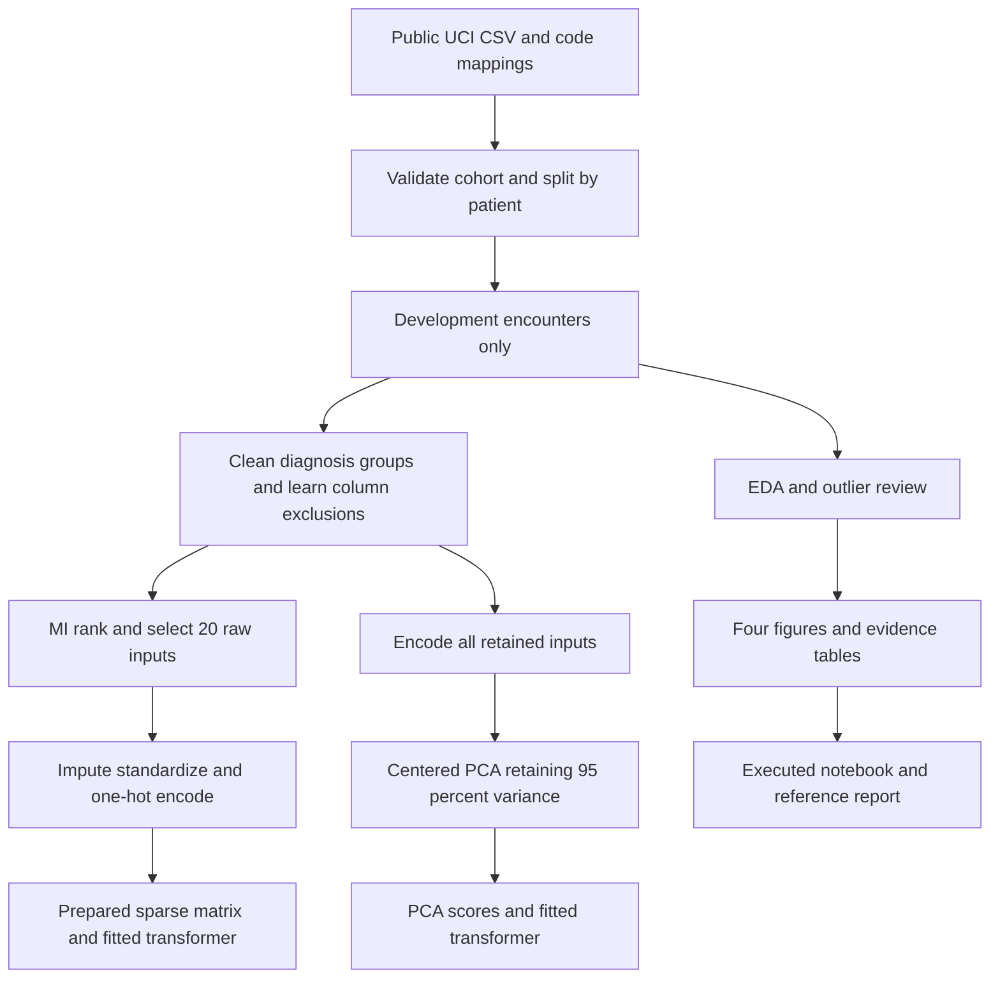

# GenoMining Section 3: Data Preprocessing and Exploratory Analysis

This branch explains and implements **Section 3 of the supplied requirements**. We examine historical diabetes hospital encounters, identify data-quality issues, and prepare inputs for a later hospital-readmission prediction study. For example, an analyst can inspect whether prior inpatient visits are associated with recorded early readmission, then transform the original mixed columns into a consistent numerical matrix.

**Start with [notebook 1](notebooks/01_data_preparation.ipynb), then [notebook 2](notebooks/02_exploratory_analysis.ipynb).** Both contain the analysis code directly in their cells and retain their executed outputs. Notebook 1 downloads and validates the data, defines the target, and separates patients. Notebook 2 contains the EDA and preprocessing code, with brief EDA observations beside the results.

Notebook 2 saves four figures and five CSV tables under `notebooks/outputs/`, plus encoded development data in `data/processed/training.csv`. The training file includes `target` and two ID columns; exclude the IDs from model inputs. For later cross-validation, refit preprocessing inside each training fold.

The earlier [focused notebook](section3/section3_eda_preprocessing.ipynb), [reference report](section3/reports/section3_reference_report.pdf), and Python workflow remain as separate reference material. The commands below headed "Earlier Section 3 workflow" refer to that implementation.

Branch: `codex/section-3-eda-preprocessing`. The inherited full-project implementation remains available; this section's commands and submission ZIP use only the data-preparation and EDA/preprocessing workflow. [The original project guide](docs/FULL_PROJECT_GUIDE.md) describes later modeling phases.

## What is already complete

- Source validation, eligibility rules, data dictionary, and patient-separated partitions.
- Development-only EDA: structure, class balance, missingness, numerical distributions, boxplots, categorical associations, and a correlation heatmap.
- Documented handling of missing values and outliers; numeric standardization and categorical encoding.
- Independent mutual-information selection of 20 raw inputs, before one-hot encoding.
- PCA on the full encoded representation, with a measured 95% variance target.
- Two notebooks with direct analysis code, four essential figures, and five supporting tables. The earlier focused workflow also has a six-page reference report.

See [requirements coverage](section3/REQUIREMENTS_COVERAGE.md) for a requirement-by-requirement evidence map. A complete checklist supports review; it cannot guarantee a particular grade.

## Run notebooks 1 and 2

Install `requirements.txt` in a Python 3.12 environment, then select that environment in Jupyter or VS Code. Open the complete project folder and run each notebook from top to bottom, starting with notebook 1. Notebook 1 downloads the public UCI data when necessary; notebook 2 then reads its saved patient-separated cohort.

To execute both notebooks with the project's existing notebook runner:

```bash
python scripts/build_notebooks.py --execute --through 2
```

The runner preserves the cells in notebooks 1 and 2. Edit those notebooks directly; they are no longer regenerated from Python analysis code. Running the generator without `--execute` also preserves them.

## Earlier Section 3 workflow

Use Python 3.12. The delivered analysis used Python 3.12.14 and scikit-learn 1.7.2. From a terminal:

```bash
git clone --branch codex/section-3-eda-preprocessing https://github.com/Marchosias405/GenoMining.git
cd GenoMining
```

On Windows PowerShell:

```powershell
py -3.12 -m venv .venv
.\.venv\Scripts\python.exe -m pip install -r requirements.txt
.\.venv\Scripts\python.exe -m section3.run
.\.venv\Scripts\python.exe -m pytest tests/test_section3.py -q --junitxml=section3/outputs/test_results.xml
.\.venv\Scripts\python.exe -m section3.build_notebook --execute
```

On macOS/Linux:

```bash
python3.12 -m venv .venv
.venv/bin/python -m pip install -r requirements.txt
.venv/bin/python -m section3.run
.venv/bin/python -m pytest tests/test_section3.py -q --junitxml=section3/outputs/test_results.xml
.venv/bin/python -m section3.build_notebook --execute
```

The first run downloads the public UCI dataset if needed. It generates the cohort and patient split, then runs Section 3. **It does not train classifiers.** The focused analysis took about 23 seconds after loading the data on the development machine; installation, download and first-time splitting take extra time. Runtime varies by computer.

Subsequent runs reuse outputs only when source, data, environment, and output hashes match. Use `python -m section3.run --force` to recompute this section. Commands below assume `python` refers to the environment above.

```bash
python -m section3.verify
python -m section3.package --zip ../outputs/GenoMining-section3-submission.zip
```

Run verification after executing the notebook and tests. The ZIP includes the focused source, public data, prepared matrices, fitted transformers, notebook, evidence, study materials and reference report. Git stores the smaller evidence and source; the large reproducible arrays, transformers and original data are omitted from Git.

### Colab or Kaggle

Clone the branch or extract the focused ZIP. Set the working directory to its project root, then install dependencies and run the notebook. In Colab:

```python
%cd /content/GenoMining
%pip install -r requirements.txt
```

Use `/kaggle/working/GenoMining` in Kaggle. Enable internet for installation/download. Restart the runtime if it has already imported different NumPy/scikit-learn versions. Open `section3/section3_eda_preprocessing.ipynb` and run all cells. If the notebook cannot find the project, set the working directory to the folder containing both `section3/` and `readmission/`.

`build_notebook --execute` regenerates the notebook before executing it; preserve your own notebook edits before using that builder. Normal interactive Run All keeps your edits. The saved outputs can also be read directly on GitHub without installing anything.

### Regenerate the reference report

The PDF is included; rebuilding it is optional. It uses measured `summary.json` and evidence tables:

```bash
python -m pip install -r section3/requirements-report.txt
python -m section3.build_reference_report
```

The builder regenerates both PDF and Markdown. Preserve any manual edits to the Markdown first. Your final academic report is a separate team-authored document.

## How the files work together



The calibration and test patients are set aside before exploratory decisions. All `fit` operations here use development data. The original data loader sees the complete cohort to create those fixed partitions, but Section 3 does not examine held-out relationships or fit transformations on them.

| File or folder | What it does and how it connects |
|---|---|
| `section3/run.py` | Entry point: ensures data preparation, invokes the analysis, and validates hashes before reusing outputs. |
| `section3/analysis.py` | Implements EDA, outlier screening, preprocessing, MI, PCA and the four figures. Reads the development cohort and writes `section3/outputs/`. |
| `section3/config.json` | Section-specific choices: top 20 inputs, 200 Isolation Forest trees, 3% flag fraction, 95% PCA variance target. |
| `config.json` | Shared seed 459 and CPU settings, preserving the proposal's patient partitions. |
| `readmission/data.py` | Downloads/validates UCI data, excludes death/hospice encounters, defines the target and groups patients into partitions. |
| `readmission/features.py` | Shared cleaner, diagnosis grouping, independent MI selector, and numeric/categorical encoder. The focused analysis reuses these rules. |
| `readmission/common.py` | Shared paths, numerical-input names, source URLs, hashes and environment metadata. |
| `readmission/pipeline.py` | Runs/reuses the original data-preparation phase. The Section 3 entry point requests only that phase. |
| `requirements.txt` and `requirements-lock.txt` | Installable direct dependencies and the original full environment record. The shared environment also supports the full project. |
| `.gitignore` and `.gitattributes` | Exclude generated bulk files from Git and preserve text/binary file bytes consistently across operating systems. |
| `section3/section3_eda_preprocessing.ipynb` | Executed walkthrough: displays evidence, inspects fitted transformations and verifies row alignment. |
| `section3/build_notebook.py` | Rebuilds and optionally executes that notebook. Requires a local Jupyter kernel, supplied by ipykernel. |
| `section3/build_reference_report.py` | Turns measured summaries/tables and selected figures into the PDF and editable Markdown reference. |
| `section3/requirements-report.txt` | Optional packages for PDF rebuilding; unnecessary for reading it. |
| `section3/verify.py` | Checks hashes, test results, notebook execution, saved matrices and metadata. Writes verification evidence. |
| `section3/package.py` | Creates the focused submission ZIP and per-file guide; excludes unrelated modeling results, caches and virtual environments. |
| `tests/test_section3.py` | Six meaningful checks for training-only fitting, MI ordering, IQR behavior, saved matrices/PCA and preprocessing audits. |
| `section3/REQUIREMENTS_COVERAGE.md` | Maps every supplied requirement to implementation, notebook evidence and report discussion. |
| `section3/STUDY_GUIDE.md` | Worked concepts, exam-style questions and short explanations to practice as a team. |
| `section3/SUBMISSION_CHECKLIST.md` | What to submit, what to review and how three teammates can divide verification and report writing. |
| `section3/FILE_GUIDE.md` | Individual description of each focused source, output and document included in the ZIP. |
| `section3/reports/` | PDF reference and editable Markdown. They explain actual findings and limitations. |
| `section3/outputs/tables/` | CSV evidence: missingness, numeric summaries, associations, column decisions, scaling/encoding audits, MI, outliers and PCA. |
| `section3/outputs/figures/` | Four essential composite figures used in the notebook and reference report. |
| `section3/outputs/summary.json` | Measured counts, dimensions and decisions consumed by the notebook and report builder. |
| `section3/outputs/manifest.json` | Source fingerprint and hashes of generated outputs, enabling safe reuse. |
| `section3/outputs/test_results.xml` and `verification.json` | Test evidence and additional artifact checks; these record actual checks rather than an assumed pass. |
| `section3/outputs/data/` | Development sparse matrix, PCA scores, row/label ledger and outlier flags. Generated locally, included in the ZIP. |
| `section3/outputs/transformers/` | Saved all-input/top-20 preprocessors and PCA; reuse learned development rules without fitting again. |
| `data/raw/` and `data/processed/` | Original public data/code mappings and the constructed cohort/split ledger; generated locally, included in the ZIP. |
| `artifacts/data_audit.json` and `artifacts/tables/data_dictionary.csv` | Shared provenance and original-column definitions. These support Section 3 even though other `artifacts/` files belong to the full project. |

## Read the results correctly

| Measured result | Why it matters |
|---|---|
| 101,766 original encounters; 99,343 eligible | Exclusions apply to encounters, not every encounter belonging to those patients. |
| 59,670 development encounters from 41,960 patients | This is the denominator for EDA and preprocessing results. |
| 6,854 positives; 11.49% of development encounters | A majority prediction achieves 88.51% accuracy while missing every positive. |
| Weight 96.81% missing; specialty 48.96%; payer 39.59% | Drop weight under the >95% rule; retain the others with explicit missing categories. |
| Zero missing cells in the eight numerical inputs | Median imputation is implemented, but changes no numeric values in this dataset. |
| 47 candidate inputs -> 42 retained -> 216 encoded | Raw feature counts differ from one-hot column counts. |
| 20 MI-selected raw inputs -> 147 encoded | MI chooses variables before category expansion; 20 is a predeclared scope choice. |
| 216 encoded columns -> 65 PCA components | These explain 95.11% of development variance, not 95.11% prediction accuracy. |
| Largest numeric Spearman correlation 0.463 | Length of stay and medication count are moderately associated; no numeric pair reaches absolute 0.80. |
| IQR flags 20,162 rows; Isolation Forest flags 1,791 | Outlier flags are method-dependent review signals; zero rows are removed as outliers. |

`None` in `A1Cresult` and `max_glu_serum` means **not performed**. It is not a missing-value token. When reading evidence CSVs containing this literal category, use `pd.read_csv(..., keep_default_na=False)` to avoid pandas converting it to NaN.

The development-labeled MI ranking puts prior inpatient visits first, followed by discharge disposition and emergency visits. This is association, not causal importance. No model performance claim is made by this section.

## Preprocessing explained with an example

For `time_in_hospital`, the fitted development mean is about 4.364 days and the population standard deviation is about 2.953. A four-day stay is transformed to approximately `(4 - 4.364) / 2.953 = -0.123`. Standardization makes numerical scales comparable, but does not remove skew or outliers. The exact values and worked rows are in `numeric_transform_audit.csv` and `transformation_examples.csv`.

Categorical fields follow a different path. A missing `payer_code` becomes the literal `Missing` category. An age band stays categorical. Broad diagnosis groups replace detailed ICD-9 codes using fixed rules, without reading outcomes. One-hot encoding expands categories into indicator columns and pools categories occurring fewer than 25 times in the training data. An unseen category maps to the learned rare-category column if present, or an all-zero block otherwise.

Outlier handling is a documented retention decision. IQR is `Q3 - Q1`; observations outside `Q1 - 1.5*IQR` and `Q3 + 1.5*IQR` are flagged. For emergency and outpatient visits both quartiles are zero, so any positive visit count is flagged. That does not make a visit erroneous. Isolation Forest supplies a multivariable check on **log1p-transformed** numerical inputs; the primary encoded matrix uses the original counts followed by standardization. No capping or deletion is silently applied.

No synthetic rows, SMOTE, oversampling or data augmentation are used. Preserving prevalence makes descriptive counts interpretable. If resampling is explored later, it must occur only inside training folds and must respect mixed clinical feature types.

## Load the prepared inputs

After `python -m section3.run`:

```python
from pathlib import Path
import joblib
import numpy as np
import pandas as pd
from scipy import sparse

out = Path('section3/outputs')
X_development = sparse.load_npz(out/'data/development_top20.npz')
rows = pd.read_csv(out/'data/development_row_index.csv')
y_development = rows['target'].to_numpy()
feature_names = pd.read_csv(out/'tables/encoded_feature_names.csv')
assert X_development.shape == (len(rows), len(feature_names))

preprocessor = joblib.load(out/'transformers/preprocessor_top20.joblib')
# new_encounters must contain the original 47 candidate inputs, without IDs/target.
# X_new = preprocessor.transform(new_encounters)

pca_scores = np.load(out/'data/development_pca.npz')['scores']
assert len(pca_scores) == len(rows)
```

Load only trusted joblib files. The row ledger ties every matrix row to an encounter ID, patient ID and target. IDs belong in that ledger, not in the input matrix.

**For later cross-validation, fit a fresh pipeline within each training fold.** The exported matrix already used all development labels for MI; cross-validating directly on it would leak validation-label information. The main project's classifier pipeline already fits these transformations inside its folds. PCA is a separate Section 3 diagnostic alternative, not a change to those classifier experiments.

## Study and report workflow

1. Read this README and run the focused notebook together once.
2. Explain each plot's population, axes and limitation without looking at the reference report.
3. Follow [the study guide](section3/STUDY_GUIDE.md) and reproduce one numeric transformation and one matrix shape.
4. Review [requirements coverage](section3/REQUIREMENTS_COVERAGE.md). Each teammate should be able to explain why the preprocessing order prevents leakage.
5. Use the evidence and reference to write your own final report. Keep only essential figures, explain decisions and limitations, add accurate member contributions, and check your course's final format rules.

The screenshot specifies content, but does not state a page limit, naming convention or upload format. Check those course-specific submission details before uploading. The reference report is a learning resource and is clearly separate from your final team report.

## Dataset and method references

The public dataset is [UCI Diabetes 130 US Hospitals for Years 1999-2008](https://doi.org/10.24432/C5230J), CC BY 4.0. Its original paper is [Strack et al. 2014](https://doi.org/10.1155/2014/781670). Implementation references: [mutual information](https://scikit-learn.org/1.7/modules/generated/sklearn.feature_selection.mutual_info_classif.html), [PCA](https://scikit-learn.org/1.7/modules/generated/sklearn.decomposition.PCA.html), and [Isolation Forest](https://scikit-learn.org/1.7/modules/generated/sklearn.ensemble.IsolationForest.html). All findings in this branch come from the executed project data, with source hashes saved for audit.
