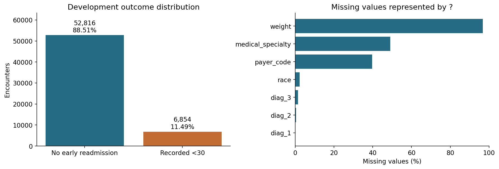
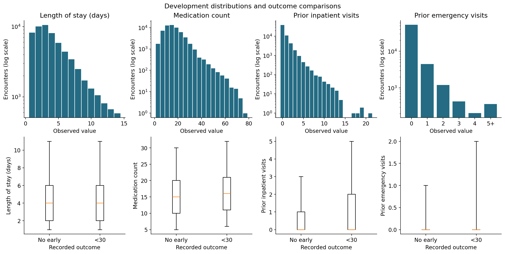
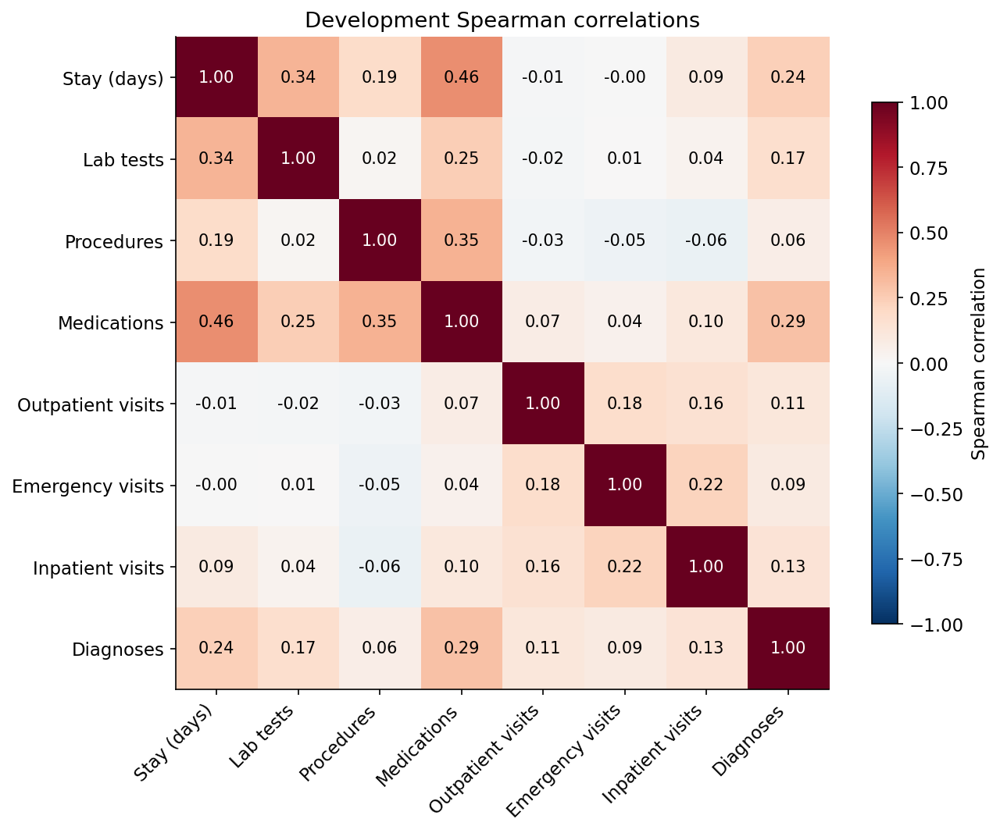
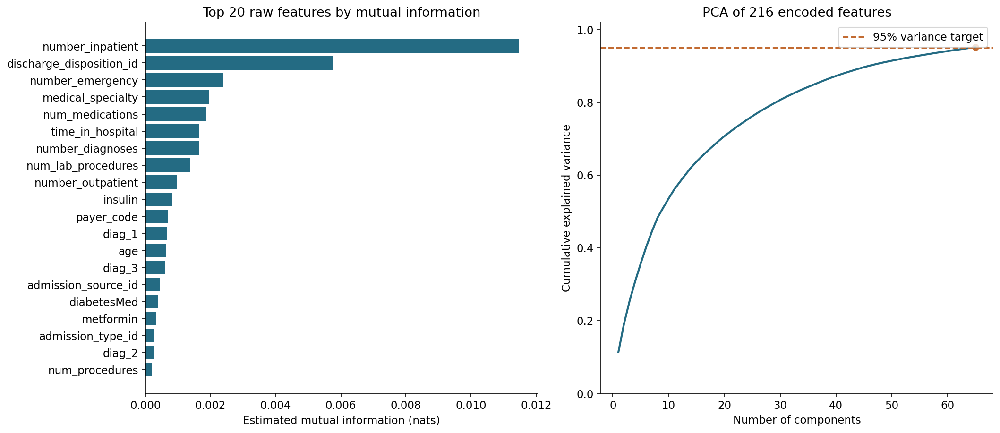

# Section 3: exploratory analysis and preprocessing

## Data and methods
We analyzed 59,670 development encounters from 41,960 patients.
The target was recorded readmission in the released <30 category, with >30 and NO as negatives.
Patients were separated before analysis; calibration and test patients remained reserved.
We examined missingness, distributions, outcome comparisons, and Spearman correlations.

## Main findings
Early readmission occurred in 11.49% of development encounters. Weight was
96.81% missing. Prior hospital use was
concentrated at zero with a long upper tail. The strongest numerical correlation was
0.463, between length of stay and medication count.
These results support attention to class imbalance, missingness, and unusual utilization.
Category-level outcome comparisons were unadjusted and did not establish causation.

## Preprocessing decisions
We removed features above 95% missingness and development-constant features, retaining
42 raw predictors. We preserved laboratory None and coded unknown categories,
and used .fillna() with development medians for numerical values and Missing for categories.
No numerical values needed filling in this run.
We standardized numerical inputs and one-hot encoded categorical inputs, pooling categories
with fewer than 25 development occurrences. This produced 216 encoded columns.

IQR flagged 20,162 encounters. We retained every eligible encounter because unusual values
were not confirmed errors. No data augmentation or oversampling was performed.

## Feature selection and dimensionality reduction
An independent mutual-information filter selected 20 raw predictors,
producing 147 encoded columns. Prior inpatient visits, discharge disposition,
and emergency visits ranked highest. Separately, PCA retained 65 components
explaining 95.11% of the full encoded variance. This measures retained
representation variance, not classification accuracy. Every learned step must be refitted
inside each training fold for later cross-validation.

## Limitations
Encounters came from historical US records and may miss readmissions elsewhere.
Repeated encounters are correlated within patients. The source does not support reliable
chronological or hospital holdouts. Our findings are descriptive and do not establish
intervention effects or clinical readiness.

## Sources
- Clore et al. (2014). UCI Diabetes 130-US Hospitals. https://doi.org/10.24432/C5230J
- scikit-learn documentation: https://scikit-learn.org/1.7/modules/preprocessing.html
- Mutual information: https://scikit-learn.org/1.7/modules/generated/sklearn.feature_selection.mutual_info_classif.html
- PCA: https://scikit-learn.org/1.7/modules/generated/sklearn.decomposition.PCA.html