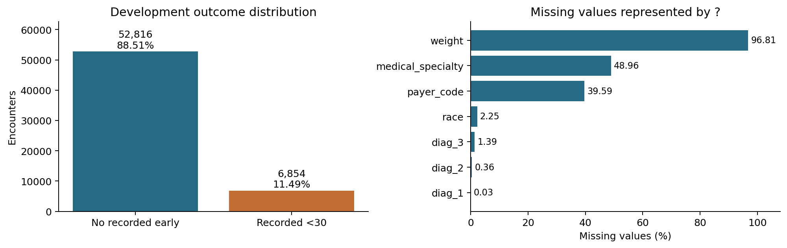
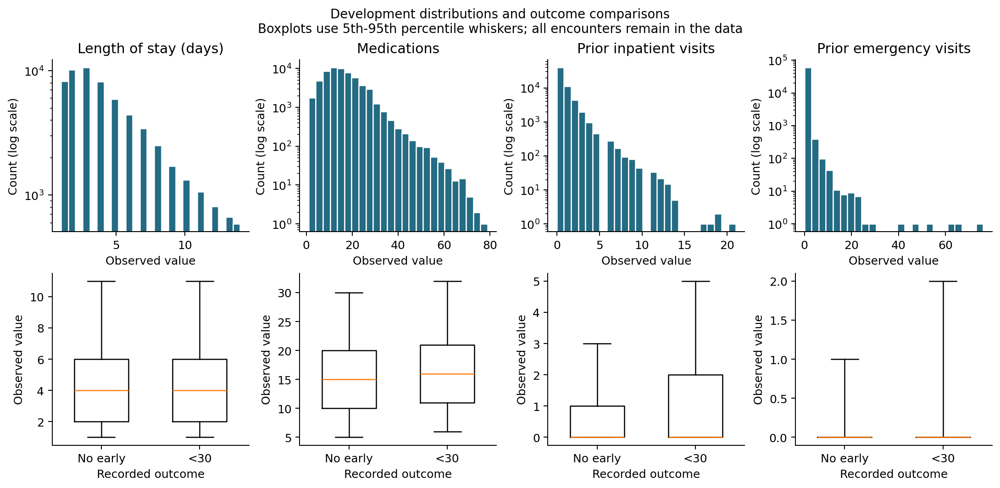
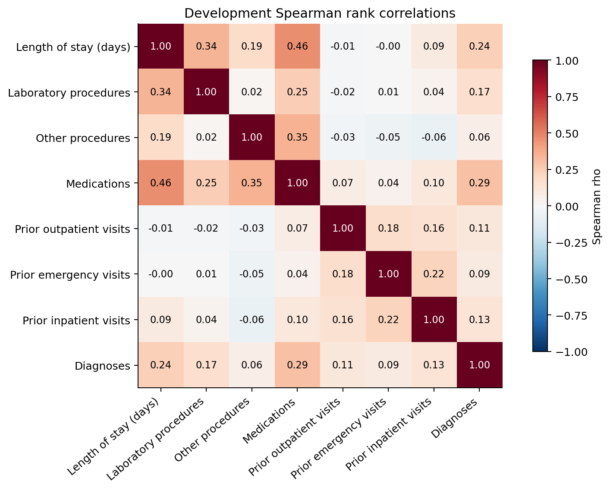
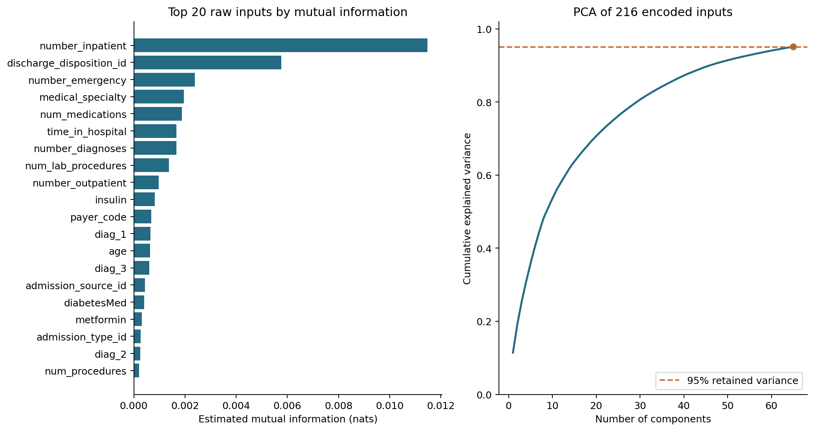

# Hospital Readmission Data Preparation

Section 3 reference report

This analysis prepares historical diabetes hospital encounters for a later readmission study. Its main findings are pronounced class imbalance, substantial missingness in a few categorical fields, and skewed prior-utilization counts. The preprocessing preserves valid unusual encounters, separates patients before learning transformations, and produces interpretable selected inputs alongside a PCA alternative. This document covers exploratory analysis and preprocessing only.

## Analysis population

The UCI release contains 101,766 encounters from 71,518 patients at 130 US hospitals during 1999-2008 [1]. A row is an encounter, so a patient can contribute multiple rows. The source has 47 candidate inputs, two identifiers and one recorded outcome. Eight inputs are numerical counts or durations; the other 39 are treated as categorical.

| Population | Encounters | Patients |
| --- | --- | --- |
| Original release | 101,766 | 71,518 |
| Eligible cohort | 99,343 | 69,990 |
| Development for this analysis | 59,670 | 41,960 |
| Reserved calibration | 19,746 | 14,025 |
| Reserved test | 19,927 | 14,005 |

Exclude 2,423 encounters with death or hospice discharge codes 11, 13, 14, 19, 20 or 21. A five-fold grouped assignment with seed 459 places three folds in development and one each in calibration and test. No patient crosses partitions. Every distribution, association, learned transformation and feature-selection result below uses development data only.



Figure 1. Development class distribution and missingness. There are 6,854 recorded early readmissions (11.49%). The eligible full-cohort rate is 11.39%; the denominators differ.

The positive outcome is the released <30 category; >30 and NO form the negative class. NO means no recorded readmission in this release, not verified absence everywhere. Prediction is intended at discharge, when completed-stay variables are available.


<!-- page break -->

## Distributions and class imbalance

An always-negative decision would match 88.51% of development labels while identifying no early readmissions. Accuracy alone would therefore be inadequate for later model evaluation. The class proportions are preserved throughout this section.



Figure 2. Four representative distributions and comparisons by outcome. Histograms include all observations and use log count axes. Boxplots use 5th-95th percentile whiskers, with outside points hidden for readability; no rows are removed.

| Numerical input | Median | 99th pct | Maximum | Zero % |
| --- | --- | --- | --- | --- |
| Length of stay in days | 4 | 13 | 14 | 0.0 |
| Medications | 15 | 43 | 79 | 0.0 |
| Prior inpatient visits | 0 | 6 | 21 | 66.6 |
| Prior emergency visits | 0 | 3 | 76 | 88.8 |

Length of stay has a median of four days, whereas medication counts extend to 79. Emergency visits have a median of zero, a 99th percentile of three and a maximum of 76. A mean alone would conceal this concentration at zero and the long tail. Standardization changes scale, not skewness; the tail remains in the prepared numerical inputs.

The early-readmission group has a higher upper quartile for prior inpatient visits (two versus one), but both groups have a median of zero. Medication medians are close (16 versus 15). The overlapping boxplots discourage a claim that a single variable cleanly separates outcomes. Full summaries of all eight numerical fields are supplied in numeric_summary.csv.


<!-- page break -->

## Relationships and interpretation



Figure 3. Spearman correlations between the eight numerical inputs, using development encounters only.

The largest absolute off-diagonal correlation is between length of stay and medication count (rho = 0.463). No pair reaches the predeclared absolute-rho threshold of 0.80. This gives no evidence for removing one of these numeric fields solely because of very strong pairwise rank correlation. It does not rule out nonlinear dependence or redundancy involving categorical variables.

Categorical associations provide another descriptive view. The HbA1c category None contains 49,453 encounters and has an observed early-readmission rate of 11.69%; Norm contains 2,968 encounters with a rate of 10.58%. These are unadjusted encounter-level rates. Testing practices, illness severity and repeat encounters may affect the comparison; it cannot establish that ordering a test causes a change in readmission.

Small categories require special care. The tables retain counts next to rates so that a high percentage from a handful of encounters is not mistaken for a stable pattern. No inferential significance or causal effect is claimed from these exploratory comparisons.


<!-- page break -->

## Cleaning missing values and unusual records

Only ? is parsed as missing. Weight is 96.81% missing in development and is removed by the rule excluding inputs above 95% missingness. Medical specialty (48.96%) and payer code (39.59%) remain, with missingness encoded explicitly. The lab category None means not performed; it occurs in 82.88% of HbA1c values and 94.90% of glucose-test values and is preserved.

Four medication columns are constant in development after cleaning: acetohexamide, examide, citoglipton and metformin-rosiglitazone. Together with weight, their removal reduces 47 candidate inputs to 42. These are training-learned exclusions rather than assumptions about every possible future cohort. Diagnosis codes are mapped to fixed broad ICD-9 groups, retaining missing values and reducing sparse categorical detail.

## Imputation scaling and encoding

The numerical branch uses median imputation followed by StandardScaler: subtract the training mean and divide by the training population standard deviation. The development numerical inputs contain zero missing cells, so median imputation is a robustness rule and changes no values in this run. The audit confirms means approximately zero and population standard deviations approximately one after scaling.

The categorical branch fills missing values with Missing and uses one-hot encoding. Categories with fewer than 25 training occurrences are pooled. Unseen categories map to that pooled column where it exists; otherwise the feature has an all-zero block. Age bands and integer-coded admission/discharge categories are not treated as measured quantities. Encoding all 42 retained inputs produces 216 numerical columns.

## Outlier handling

| Screen | Flagged encounters | Action |
| --- | --- | --- |
| Any 1.5 IQR fence | 20,162 (33.79%) | Retain for analysis |
| Isolation Forest | 1,791 (3.00%) | Retain for analysis |
| Removed as outliers | 0 | No automatic deletion |

Outpatient and emergency visit counts have IQR zero, so the IQR rule flags every nonzero count. Isolation Forest provides a complementary screen on log1p-transformed, imputed and standardized numerical values, using 200 trees and a predeclared 3% flag fraction [4]. Its flagged records have median prior emergency and inpatient counts of two each, compared with zero in the unflagged group. Flags indicate unusual utilization, not proven errors. Without adjudicated error labels, deleting these records could remove useful risk variation.

No augmentation, oversampling or synthetic rows are used. The original class prevalence is retained for this analysis. Any future resampling must occur inside training folds; applying it before splitting can leak information or create unrealistic mixtures of clinical categories.


<!-- page break -->

## Independent feature selection and dimensionality reduction

Mutual information ranks each whole cleaned input against the development target before one-hot encoding. Counts and categories are treated as discrete; missing values have their own code. This is a supervised filter independent of classifier fitting [2]. The predeclared top-20 option retains 20 raw inputs and yields 147 encoded columns.



Figure 4. Independent mutual-information rankings and cumulative variance for the separate PCA representation. Both are fitted using development encounters only.

Prior inpatient visits rank first (0.01148 nats), followed by discharge disposition (0.00576) and emergency visits (0.00239). The scores describe estimated univariate dependence, not causal influence or an accuracy contribution. MI can favor high-cardinality variables and miss interactions; 20 features is a bounded comparison choice rather than a demonstrated optimum.

PCA is applied to the full 216-column encoded representation, with standardized numerical inputs and binary categorical indicators. The input is centered; the one-hot indicators are not separately scaled to unit variance. Full SVD retains 65 components explaining 95.11% of development variance [3]. The first two components explain only 19.15%, so a 2D projection would omit most variation.

PCA does not use labels and produces combinations of features, reducing direct clinical interpretability. Its retained variance is not evidence of better readmission prediction. The PCA outputs are a separate diagnostic alternative and do not replace the proposal classifier inputs. Any later cross-validation must refit cleaning, imputation, encoding, MI and any PCA inside each training fold.


<!-- page break -->

## Reproducibility and limitations

The implementation records source and data hashes, package versions, patient partitions, feature decisions, encoding widths and matrix row order. Six focused tests check training-only imputation/scaling, selection before encoding, zero-IQR behavior, sparse-matrix reproduction, PCA reproduction and alignment of the audit with development data. The executed notebook demonstrates the same results and an unseen-category transform without refitting.

```bash
python -m section3.run
python -m pytest tests/test_section3.py -q
python -m section3.build_notebook --execute
```

Run these commands from the repository root after installing requirements.txt. The first command automatically obtains the public data if necessary, prepares the fixed patient split and runs this section only. Matching outputs are reused after checking their hashes; --force recomputes this section. The prepared sparse matrix, PCA scores and fitted transformers are regenerated locally and are not required to inspect the saved notebook.

## Limits of the evidence

This is a retrospective analysis of historical US encounters, not evidence of performance in current Canadian hospitals. Missingness may reflect selective documentation and care processes. The release does not support reliable external-hospital or chronological validation because the required hospital identifiers and usable dates are absent. Repeated encounters contribute correlated observations. Label capture can miss readmissions elsewhere. These limitations persist after technical cleaning.

The four selected figures cover class balance and missingness, distributions and outcome comparisons, numerical correlations, and feature selection with PCA. Detailed tables provide checks without crowding the report with every generated display. Classifier results, calibration, clustering comparisons and clinical deployment claims are outside this section.

## References

[1] Clore, Cios, DeShazo and Strack. Diabetes 130 US Hospitals for Years 1999-2008. UCI Machine Learning Repository. Dataset DOI 10.24432/C5230J. CC BY 4.0. [Source](https://doi.org/10.24432/C5230J)

[2] scikit-learn 1.7.2. mutual_info_classif documentation. Estimating dependence between discrete features and a discrete target. [Source](https://scikit-learn.org/1.7/modules/generated/sklearn.feature_selection.mutual_info_classif.html)

[3] scikit-learn 1.7.2. PCA documentation. Centering, SVD and explained variance. [Source](https://scikit-learn.org/1.7/modules/generated/sklearn.decomposition.PCA.html)

[4] scikit-learn 1.7.2. IsolationForest documentation. Anomaly scoring and contamination setting. [Source](https://scikit-learn.org/1.7/modules/generated/sklearn.ensemble.IsolationForest.html)

All numerical results and figures in this reference come from the saved Section 3 run. The root README and STUDY_GUIDE.md explain the implementation for team review. Use this reference to understand and verify the work before writing the team-authored final report.
